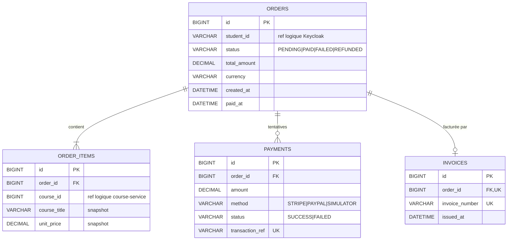

# 💳 LearnHub — marketplace-service (Microservice 5)

> ESPRIT · Module AWD · 4SSA13 · Groupe G5 — Responsable : **Selim Hechmi (Team Lead)**
> Port **8085** · MySQL **db_marketplace** · Eureka · OpenFeign + Resilience4j · RabbitMQ · Swagger

Commandes d'achat de cours, passerelle de paiement **sandbox simulée** (Stripe / PayPal / Simulateur),
génération des factures, et publication de l'événement critique **PaymentCompleted**.

---

## 1. Base de données : quelles tables créer ?

**Oui, 4 tables** dans `db_marketplace` (et uniquement celles-là). Hibernate les crée tout seul au
démarrage (`ddl-auto: update`) ; le script manuel est dans `docs/database/marketplace_schema.sql`.

| Entité JPA | Table MySQL | Rôle |
|---|---|---|
| `Order` | `orders` | La commande. Nom au pluriel car `ORDER` est un **mot réservé SQL** (sinon erreur au démarrage). |
| `OrderItem` | `order_items` | **Table d'association** commande ↔ cours (N-N) + snapshot titre/prix. |
| `Payment` | `payments` | Chaque tentative de paiement (une commande peut échouer puis réussir). |
| `Invoice` | `invoices` | Une facture par commande payée. |

Aucune table `course`, `student` ou `user` : ces données appartiennent à **course-service** et à **Keycloak**.

### La table d'association `order_items`

Une commande contient **plusieurs cours** et un cours apparaît dans **plusieurs commandes** → relation
**N-N** entre `orders` et le catalogue. Comme le catalogue vit dans une **autre base** (`db_course`),
on ne peut ni faire de `@ManyToMany`, ni de FK SQL vers `courses`. La table d'association est donc
une **entité à part entière** :

```
orders (1) ──────< order_items >────── (N) cours [course-service, db_course]
   id  ◄── FK order_id          course_id ──► référence LOGIQUE (pas de FK)
                                course_title, unit_price ──► SNAPSHOT figé à l'achat
```

- `order_id` → **vraie clé étrangère** (même base, autorisée).
- `course_id` → **identifiant logique** `Long`, aucune contrainte SQL (règle d'or du professeur).
- `course_title` + `unit_price` → **copie** obtenue via OpenFeign (`GET /api/courses/{id}/pricing`) :
  si le formateur change son prix demain, la facture d'hier reste juste.
- Contrainte `UNIQUE (order_id, course_id)` : un même cours ne peut pas apparaître deux fois dans une commande.

### Diagramme entité-relation



Les attributs sont **exactement** ceux du cahier des charges (aucune colonne ajoutée).

---

## 2. Lancer le service

### Option A — Seul, pour Postman (recommandé pour développer)
Pas besoin d'Eureka, de course-service ni du Config Server : un **catalogue simulé** (cours 1 à 7)
remplace l'appel Feign.

```bash
# MySQL doit tourner (XAMPP/WAMP ou Docker). RabbitMQ est facultatif (les erreurs d'envoi sont journalisées).
mvn spring-boot:run -Dspring-boot.run.profiles=standalone
```

### Option B — Dans l'architecture complète
Eureka (:8761), Config Server (:8888, optionnel), RabbitMQ (:5672), course-service (:8082) démarrés :
```bash
mvn spring-boot:run
```

### Option C — Docker
```bash
docker build -t learnhub/marketplace-service .
```
Fragment `docker-compose.yml` à ajouter au fichier commun :
```yaml
  mysql-marketplace:
    image: mysql:8.0
    environment:
      MYSQL_ROOT_PASSWORD: root
      MYSQL_DATABASE: db_marketplace
    ports: ["3310:3306"]
    volumes: [marketplace-data:/var/lib/mysql]

  marketplace-service:
    image: learnhub/marketplace-service
    build: ./marketplace-service
    ports: ["8085:8085"]
    environment:
      MYSQL_HOST: mysql-marketplace
      MYSQL_PORT: 3306
      MYSQL_PASSWORD: root
      EUREKA_URL: http://eureka-server:8761/eureka/
      CONFIG_SERVER_URL: http://config-server:8888
      RABBITMQ_HOST: rabbitmq
    depends_on: [mysql-marketplace, eureka-server, rabbitmq]
```

- Swagger UI : http://localhost:8085/swagger-ui.html
- Santé : http://localhost:8085/actuator/health
- Au premier démarrage, **12 commandes de démonstration** sont insérées pour le backoffice
  (désactiver avec `marketplace.seed-demo-data=false`).

---

## 3. API REST

Identité : en-têtes posés par l'API Gateway après validation du JWT —
`X-User-Id` (obligatoire, sinon **401**), `X-User-Roles` (`STUDENT`, `ADMIN`…), `X-User-Email`.

| Méthode | Endpoint | Rôle | Codes |
|---|---|---|---|
| POST | `/api/orders` | Créer une commande (Feign → course-service) | 201, 400, 404, 409, 503 |
| GET | `/api/orders/my` | Historique de l'étudiant connecté | 200 |
| GET | `/api/orders` | **[ADMIN]** Liste paginée + filtres `status, studentId, courseId, q, from, to` | 200, 403 |
| GET | `/api/orders/{id}` | Détail (lignes, paiements, facture) | 200, 403, 404 |
| PUT | `/api/orders/{id}` | Modifier les cours (PENDING/FAILED) | 200, 409 |
| PATCH | `/api/orders/{id}/status` | **[ADMIN]** PENDING ↔ FAILED, PAID → REFUNDED | 200, 409 |
| POST | `/api/orders/{id}/refund` | **[ADMIN]** Remboursement | 200, 409 |
| DELETE | `/api/orders/{id}` | Supprimer (non payée uniquement) | 204, 409 |
| GET | `/api/orders/stats` | **[ADMIN]** KPI du tableau de bord | 200 |
| GET | `/api/orders/check-purchase?studentId=&courseId=` | Feign interne (community-service) | 200 |
| POST | `/api/payments/checkout` | Paiement sandbox | **200** succès / **402** refus / 409 |
| GET | `/api/payments` | **[ADMIN]** Journal des transactions (`status`, `method`) | 200 |
| GET | `/api/payments/{id}` | **[ADMIN]** Détail transaction | 200, 404 |
| GET | `/api/payments/order/{orderId}` | Tentatives d'une commande | 200 |
| GET | `/api/invoices/{id}` | Facture officielle | 200, 403, 404 |
| GET | `/api/invoices/order/{orderId}` | Facture d'une commande | 200, 404 |
| GET | `/api/invoices/number/{n}` | **[ADMIN]** Recherche par numéro | 200, 404 |
| GET | `/api/invoices` | **[ADMIN]** Registre des factures | 200 |

### Règles de la passerelle sandbox
| Carte / option | Résultat |
|---|---|
| `4242424242424242` (Stripe) | ✅ SUCCESS |
| Stripe sans numéro de carte | 400 |
| se termine par `0002` (Stripe) | ❌ carte déclinée |
| se termine par `9995` (Stripe) | ❌ fonds insuffisants |
| PayPal / Simulateur | ✅ SUCCESS (le numéro de carte est ignoré) |
| `"simulateFailure": true` | ❌ refus forcé |
| un des cours a déjà été payé dans une autre commande | 409 |

Devise : les prix viennent du catalogue en **TND** ; une autre devise est refusée (400) car aucune conversion n'est faite.

Références générées : `pi_…` (Stripe), `PAYID-…` (PayPal), `SIM-AAAAMMJJhhmmss-…` (Simulateur).
Le numéro de carte n'est **jamais stocké**.

### Cycle de vie d'une commande
```
           checkout OK                 refund (ADMIN)
PENDING ───────────────► PAID ─────────────────────► REFUNDED
   │  ▲                    ▲
   │  │ PUT / PATCH        │ checkout OK
   ▼  │                    │
 FAILED ───────────────────┘
 (checkout refusé)
```

### Format d'erreur standard
```json
{
  "timestamp": "2026-11-25T14:02:11",
  "status": 409,
  "error": "Conflict",
  "message": "Cours déjà acheté(s) par cet étudiant : [2]",
  "path": "/api/orders"
}
```

---

## 4. Contrats avec les autres membres du groupe

### → course-service (Nawres) : OpenFeign
`GET /api/courses/{id}/pricing` doit renvoyer :
```json
{ "id": 1, "title": "Développement web : HTML, CSS et JavaScript", "price": 59.00, "status": "PUBLISHED" }
```
Un cours non `PUBLISHED` est refusé (400). Panne / timeout → circuit breaker ouvert → **503** (jamais de faux prix).

### → learning-journey-service (Aziz) : RabbitMQ
- Exchange : `learnhub.marketplace.exchange` (Topic) · Routing key : `payment.completed`
- Queue (déclarée par le Marketplace) : `journey.payment-completed.queue` (+ DLQ `.dlq`)
- **Un message par cours acheté**, publié **après le commit** de la transaction :
```json
{ "studentId": "a1b2c3d4-…-0001", "courseId": 1, "orderId": 42, "paidAt": "2026-11-25T14:02:11" }
```
Exemple de consommateur côté journey :
```java
@RabbitListener(queues = "journey.payment-completed.queue")
public void onPaymentCompleted(PaymentCompletedEvent event) {
    enrollmentService.enroll(event.studentId(), event.courseId());
}
// + un bean Jackson2JsonMessageConverter (avec JavaTimeModule) dans sa config.
```

### → community-service (Mootez) : OpenFeign
`GET /api/orders/check-purchase?studentId=…&courseId=…` → `{ "purchased": true, "orderId": 42, … }`
pour apposer le badge « Acheteur Vérifié ».

### → api-gateway : route à ajouter
```yaml
- id: marketplace-service
  uri: lb://marketplace-service
  predicates:
    - Path=/api/orders/**,/api/payments/**,/api/invoices/**
```

---

## 5. Architecture du code

```
tn.esprit.learnhub.marketplace
├── controller/   OrderController, PaymentController, InvoiceController (+ AdminGuard)
├── service/      interfaces + impl/ (logique métier, @Transactional)
├── repository/   Spring Data JPA + Specifications (filtres dynamiques du backoffice)
├── entity/       Order, OrderItem, Payment, Invoice
├── enums/        OrderStatus, PaymentMethod, PaymentStatus
├── dto/          request/ (validation), response/, event/
├── mapper/       Entités → DTOs
├── client/       CourseClient (Feign) + fallback Resilience4j + stub "standalone"
├── messaging/    Publication RabbitMQ après commit (@TransactionalEventListener)
├── config/       RabbitMQ, OpenAPI, CurrentUser resolver, CORS, données de démo
└── exception/    GlobalExceptionHandler (@RestControllerAdvice)
```

Points forts à présenter en soutenance :
1. **Snapshot** titre/prix dans `order_items` → aucune jointure inter-bases.
2. **Événement publié après commit** → jamais d'inscription pour un paiement annulé.
3. **Verrou pessimiste** au checkout → impossible de payer deux fois la même commande en parallèle.
4. **Circuit breaker** sur course-service → 503 propre au lieu d'un timeout.
5. **Anti double-achat** : un cours déjà payé ne peut pas être recommandé (409).
6. **Facture immuable** : une commande payée ne peut pas être supprimée, seulement remboursée.
7. Test d'intégration complet : `MarketplaceFlowIntegrationTest` (`mvn test`).
