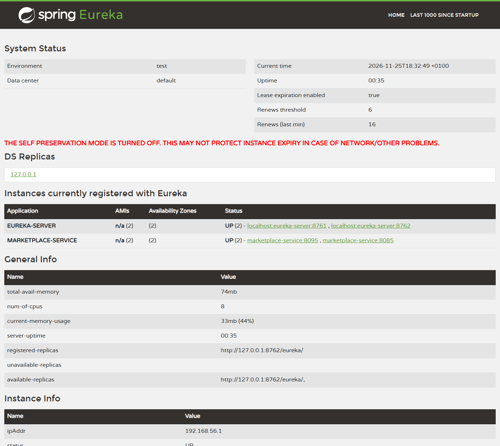

# LearnHub – Plateforme Intelligente d'Apprentissage en Ligne

[](https://spring.io/projects/spring-boot)
[](https://spring.io/projects/spring-cloud)
[](https://www.docker.com/)
[](https://www.rabbitmq.com/)
[](#)

> **Projet Académique ESPRIT – Année Universitaire 2026/2027**  
> **Module :** Architecture des Applications Web Distribuées (AWD)  
> **Classe :** 4SSA13 &nbsp;|&nbsp; **Groupe :** G5  
> **Validation 1 :** Présentation du projet et modélisation microservices (Semaine Séance 4)

---

## 👥 Équipe & Responsabilités par Microservice

| Membre | Microservice Attribué | Rôle & Responsabilité Métier | Base de Données |
|---|---|---|---|
| **Selim Hechmi** *(salim-hechmi)* | **`marketplace-service`** &amp; Co-dev `identity-service` | Commandes, panier, transactions sandbox de test, facturation et émission de l'événement `PaymentCompleted` | MySQL (`learnhub_marketplace_db`) |
| **Nawres SOUA** | **`course-service`** | Catalogue officiel, cours, chapitres hiérarchisés et ressources pédagogiques | MySQL (`learnhub_course_db`) |
| **Mohamed Aziz BEN MAMI** | **`learning-journey-service`** | Inscriptions, avancement pas à pas, complétion des leçons et objectifs | MySQL (`learnhub_journey_db`) |
| **Adam NSIRI** | **`assessment-service`** | Quiz, banques de questions, calcul automatique des scores et diplômes certifiants | MySQL (`learnhub_assessment_db`) |
| **Mootez SFAIHI** | **`community-service`** | Avis notés vérifiés (réservés aux inscrits), forums de discussion et badges | MongoDB (`learnhub_community_db`) |
| **Adam NSIRI** | **`ai-learning-coach-service`** *(Avancé)* | *(Technologie avancée)* Plans d'étude personnalisés et tutorat conversationnel par IA | MongoDB (`learnhub_aicoach_db`) |
| **Toute l'équipe** | **`identity-service`** *(Socle commun)* | Authentification sécurisée par jeton JWT, profils, permissions et rôles | MySQL (`learnhub_identity_db`) |

---

## 🎯 Problématique & Solution

- **Problématique :** Les apprenants en ligne sont confrontés à une dispersion importante de leurs outils : plateformes vidéos cloisonnées, exercices sur des sites tiers, absence de suivi centralisé et manque d'accompagnement interactif.
- **Solution LearnHub :** Une plateforme intégrée, hautement modulaire, reliant dans un même parcours utilisateur : catalogue structuré, apprentissage progressif, évaluations certifiantes, paiement en ligne, reconnaissance communautaire et accompagnement intelligent par un coach IA.

---

## 🏛️ Architecture Technique Globale

L'architecture repose sur l'écosystème **Spring Cloud** et respecte scrupuleusement la stack imposée pour le module AWD :

```
                               ┌────────────────────────────────┐
                               │   Application Web Frontend     │ (Port 3000)
                               └───────────────┬────────────────┘
                                               │ HTTP / REST
                                               ▼
                               ┌────────────────────────────────┐
                               │   Spring Cloud API Gateway     │ (Port 8080)
                               │  Routage dynamique & Filtre JWT│
                               └───────────────┬────────────────┘
                                               │
            ┌──────────────────────────────────┴──────────────────────────────────┐
            ▼                                                                     ▼
┌───────────────────────┐                                             ┌───────────────────────┐
│ Netflix Eureka Server │ (:8761 - Découverte de services)            │ Keycloak / Auth JWT   │
└───────────────────────┘                                             └───────────────────────┘
            │                                                                     │
 ───────────┴─────────────────────────────────────────────────────────────────────┴───────────
                                      7 MICROSERVICES SPRING BOOT
 ─────────────────────────────────────────────────────────────────────────────────────────────
  [identity-service]    (:8081) ── MySQL (learnhub_identity_db)
  [course-service]      (:8082) ── MySQL (learnhub_course_db)
  [journey-service]     (:8083) ── MySQL (learnhub_journey_db)
  [assessment-service]  (:8084) ── MySQL (learnhub_assessment_db)
  [marketplace-service] (:8085) ── MySQL (learnhub_marketplace_db)  <-- Selim Hechmi
  [community-service]   (:8086) ── MongoDB (learnhub_community_db)
  [ai-coach-service]    (:8087) ── MongoDB (learnhub_aicoach_db)      <-- Technologie Avancée (IA)
 ─────────────────────────────────────────────────────────────────────────────────────────────
                                 COMMUNICATIONS INTERSERVICES
   * Synchrones (OpenFeign) : Vérifications immédiates (ex: Inscription vérifiée avant avis)
   * Asynchrones (RabbitMQ) : Événements métier découplés (PaymentCompleted, ReviewPosted, etc.)
   * Conteneurisation       : Docker & Docker Compose
```

---

## 📁 Structure du Dépôt Git

Le dépôt respecte rigoureusement l'organisation demandée par l'enseignant :

```text
learnhub-4ssa13-g5/
├── Backend/
│   ├── identity-service/          # Service commun d'authentification et utilisateurs (:8081)
│   ├── course-service/            # Microservice Catalogue et cours (:8082)
│   ├── learning-journey-service/  # Microservice Inscriptions et progression (:8083)
│   ├── assessment-service/        # Microservice Quiz et certifications (:8084)
│   ├── marketplace-service/       # Microservice Commandes, paiements et factures (:8085)
│   ├── community-service/         # Microservice Avis, forums et badges (:8086)
│   ├── ai-learning-coach-service/ # Microservice Avancé IA de tutorat (:8087)
│   └── README.md
├── Frontend/                      # Application cliente Web (Port 3000)
├── Documentation/
│   ├── Presentation/              # Support de présentation séance 4 & scripts oraux
│   │   ├── LearnHub_Presentation_Validation1.html
│   │   └── Guide_Oral_Speech_Validation1.md
│   ├── Diagrams/                  # Diagrammes vectoriels SVG & documentation
│   │   ├── architecture_globale_awd.svg
│   │   ├── cas_utilisation_global.svg
│   │   ├── sequence_paiement_inscription.svg
│   │   └── diagrammes_de_classes/ (1 diagramme de classes par microservice)
│   └── Dossier_Technique/         # Dossier technique complet (Markdown, HTML imprimable, LaTeX)
│       ├── Dossier_Technique_Conception_AWD_LearnHub.md
│       ├── Dossier_Technique_Conception_AWD_LearnHub.html
│       └── Dossier_Technique_Conception_AWD_LearnHub.tex
├── docker-compose.yml             # Orchestration locale Docker (Bases MySQL, MongoDB, RabbitMQ)
└── README.md                      # Présentation générale du projet
```

---

## ⚡ Principes Clés AWD Appliqués

1. **Un microservice par capacité métier (Bounded Context) :** Aucun découpage artificiel par table ou par écran.
2. **Database-per-Service :** Chaque microservice est le propriétaire exclusif de sa base de données. Aucune base n'est partagée.
3. **Découplage temporel via RabbitMQ :** 
   - L'événement `PaymentCompleted` (émis par Marketplace) permet à `learning-journey-service` de créer l'inscription de façon asynchrone et idempotente, sans bloquer la commande de l'étudiant.
4. **Appels synchrones maîtrisés via OpenFeign :**
   - Requêtes ciblées de lecture (ex: vérification de publication de cours ou d'inscription active) protégées par un timeout court (2s) et une gestion de repli (Circuit Breaker).
5. **Sécurité Décentralisée JWT :**
   - Jetons émis par le service d'identité et validés localement par chaque microservice via leurs rôles (`ROLE_STUDENT`, `ROLE_INSTRUCTOR`, `ROLE_ADMIN`).

---

## 🚀 Guide de Démarrage Rapide

### Prérequis
- **JDK 17** ou supérieur installé
- **Apache Maven 3.8+**
- **Docker & Docker Compose** (pour l'infrastructure MySQL / RabbitMQ)
- **Node.js 18+** (pour l'application cliente Frontend)

### 1. Démarrer l'infrastructure (Bases & Message Broker)
\`\`\`bash
docker-compose up -d
\`\`\`

### 2. Démarrer un microservice Backend (Exemple : Marketplace)
\`\`\`bash
cd Backend/marketplace-service
mvn clean spring-boot:run
\`\`\`
- Documentation Swagger interactive : [http://localhost:8085/swagger-ui.html](http://localhost:8085/swagger-ui.html)
- Console base H2 (mode dev immédiat) : [http://localhost:8085/h2-console](http://localhost:8085/h2-console)

### 3. Démarrer le Frontend
\`\`\`bash
cd Frontend
npm install
npm start
\`\`\`
- Interface Web accessible sur : [http://localhost:3000](http://localhost:3000)

---

## 🛰️ Découverte de services (Eureka) & Observabilité (Actuator)

### Dashboard Eureka



- **Deux serveurs Eureka** répliqués : [http://localhost:8761](http://localhost:8761) et [http://127.0.0.1:8762](http://127.0.0.1:8762). Chacun réplique son registre vers l'autre (*DS Replicas* et *available-replicas* sur la capture), donc les deux affichent les mêmes services. Capture du second serveur : [eureka-dashboard-8762.png](Documentation/Captures/eureka-dashboard-8762.png).
- **Deux instances de `marketplace-service`** (ports `8085` et `8095`), enregistrées en même temps.
- Les microservices déclarent les **deux** serveurs dans `eureka.client.service-url.defaultZone` : si l'un tombe, ils restent visibles sur l'autre.
- Détails et marche à suivre pour rendre un service client Eureka : [Backend/eureka-server/README.md](Backend/eureka-server/README.md).

### Lancer Eureka + marketplace sur un PC du groupe

Prérequis : Java 17+ et Maven (aucune base à installer, H2 en mémoire).

```powershell
cd Backend
powershell -ExecutionPolicy Bypass -File .\start-all.ps1   # 2 Eureka + 2 instances marketplace
.\stop-all.ps1                                               # tout arrêter
```

### Endpoints Actuator exposés

`health`, `info`, `metrics`, `env`, `beans`, `mappings`, `loggers`, `configprops`, `threaddump` (sur `/actuator/...`).

| Endpoint | Capture |
|---|---|
| `/actuator` (liste des endpoints) | [actuator-index-8085.png](Documentation/Captures/actuator-index-8085.png) |
| `/actuator/health` (instance 8085, instance 8095) | [8085](Documentation/Captures/actuator-health-8085.png) · [8095](Documentation/Captures/actuator-health-8095.png) |
| `/actuator/info` | [actuator-info-8085.png](Documentation/Captures/actuator-info-8085.png) |
| `/actuator/metrics` | [actuator-metrics-8085.png](Documentation/Captures/actuator-metrics-8085.png) |
| `/actuator/metrics/http.server.requests` | [actuator-metrics-http-requests-8085.png](Documentation/Captures/actuator-metrics-http-requests-8085.png) |
| `/actuator/metrics/jvm.memory.used` | [actuator-metrics-jvm-memory-8085.png](Documentation/Captures/actuator-metrics-jvm-memory-8085.png) |
| `/actuator/env` | [actuator-env-8085.png](Documentation/Captures/actuator-env-8085.png) |
| `/actuator/mappings` | [actuator-mappings-8085.png](Documentation/Captures/actuator-mappings-8085.png) |
| `/actuator/loggers` | [actuator-loggers-8085.png](Documentation/Captures/actuator-loggers-8085.png) |
| `/actuator/health` du serveur Eureka | [actuator-eureka-health-8761.png](Documentation/Captures/actuator-eureka-health-8761.png) |

---

## 📊 Suivi de Projet & Méthodologie Git

- **Modèle de Branches :** GitFlow
  - `main` : Version livrée et validée.
  - `develop` : Intégration continue.
  - Branches nominatives de travail : `feature/SELIM-marketplace`, etc.
- **Outil de suivi :** Tableau Kanban GitHub Projects / Trello avec découpage des user stories, critères d'acceptation et statuts (À faire, En cours, Revue, Terminé).
- **Rendu Blackboard :** Dépôt Git configuré en visibilité publique avec ajout de l'enseignant en tant que collaborateur.
